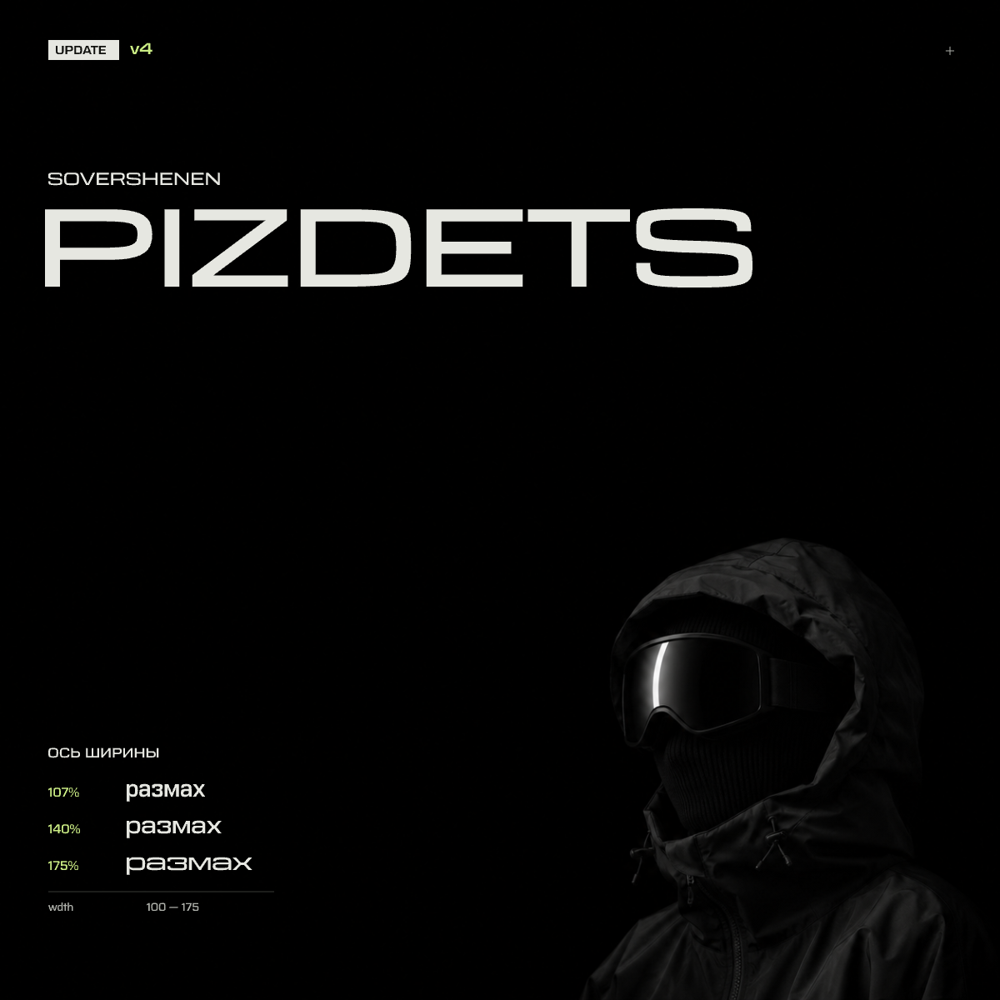

# Sovershenen Pizdets



[Оптический трекинг](docs/previews/v4-square-02.png) · [Строчные а, е и s](docs/previews/v4-square-03.png) · [Образец начертаний](docs/specimen-v4.png)

**v4 · Build 4.002** · SIL Open Font License 1.1

**RU.** Квадратный гротеск на базе [Saira](https://github.com/Omnibus-Type/Saira) (Héctor Gatti, Omnibus-Type), которая распространяется под свободной лицензией SIL Open Font License 1.1. Добавлена полная кириллица (RU, UA, BY), перерисованы буквы и цифры, пересобраны метрики, веса и кернинг. Подходит для интерфейсов, навигации и техники.

**EN.** A square grotesque based on [Saira](https://github.com/Omnibus-Type/Saira) by Héctor Gatti / Omnibus-Type, which is free software under the SIL Open Font License 1.1. Adds full Cyrillic (Russian, Ukrainian, Belarusian), redraws letters and figures, and rebalances metrics, weights and kerning. Made for interfaces, wayfinding and technical use.

> Шрифт, возможно, будет обновляться, но это не обещание. / The font may get updates, but no promises.

## v4

[Скачать TTF / Desktop](https://github.com/sxvershenen/sovershenen-pizdets/releases/download/v4/SovershenenPizdetsV4.ttf) · [Скачать WOFF2 / Web](https://github.com/sxvershenen/sovershenen-pizdets/releases/download/v4/SovershenenPizdetsV4.woff2) · [Что изменилось](docs/v4.ru.md) · [Релиз 3.17](https://github.com/sxvershenen/sovershenen-pizdets/releases/tag/v3.17)

| Axis | Range | Назначение / Use |
|---|---|---|
| `wght` | 100–900 | Насыщенность / weight |
| `wdth` | 100–175 | Ширина / width |
| `opsz` | 8–48 | Добавочный трекинг для мелкого текста / size-dependent tracking |

Именованные начертания и плейграунд стартуют на ширине 107%. В меню шрифт называется **Sovershenen Pizdets**. При обновлении с 3.17 замените предыдущую установку.

Build 4.002 uses the original **Sovershenen Pizdets** family name and replaces 3.17 when installed as an update. Named instances use width 107. Optical size adds spacing for small text, from 0.054 em at size 8 down to zero at 48.

```css
@font-face {
  font-family: "Sovershenen Pizdets";
  src: url("fonts/webfonts/SovershenenPizdetsV4.woff2") format("woff2");
  font-weight: 100 900;
  font-stretch: 100% 175%;
}
.text {
  font-family: "Sovershenen Pizdets", sans-serif;
  font-stretch: 107%;
  font-optical-sizing: auto;
}
```

## Files / Файлы

| Path | Contents |
|---|---|
| `fonts/variable/SovershenenPizdetsV4.ttf` | v4 desktop variable font |
| `fonts/webfonts/SovershenenPizdetsV4.woff2` | v4 web variable font |
| `playground/` | Local editor, reference overlays, glyph inspector and v4 build scripts |
| `sources/` | Base UFO masters and designspace from 3.17 |
| `fonts/otf/`, `fonts/ttf/` | Seven static styles from 3.17 |
| `fonts/variable/`, `fonts/webfonts/` | Also retain the original 3.17 files |

## Playground / Плейграунд

```sh
python3 -m venv .venv
. .venv/bin/activate
python -m pip install fonttools==4.68.0
python playground/server.py --open
```

В плейграунде клавиша **V / М** вне поля ввода переключает образец между 3.17 и v4. Доступны раздельные полупрозрачные слои для оригинала, Roboto и Roboto Flex. Для MicroTechnic Extended Bold можно выбрать свой файл. [Инструкция](playground/README.md)

## Build / Сборка v4

From the repository root, in the same virtual environment:

```sh
python -m pip install fontmake==3.12.2 'fonttools[woff]==4.68.0'
python playground/font/build.py sources playground/font/lab.ttf
python playground/release.py
```

The build script creates the editable playground master. The release script pins the approved Жж and У forms, adds the tracking curve and writes the desktop and web fonts.

## License / Лицензия

SIL Open Font License 1.1, see [OFL.txt](OFL.txt). This is a Modified Version of Saira, © 2020 The Saira Project Authors (https://github.com/Omnibus-Type/Saira), released under the same license. Saira declares no Reserved Font Name. Not affiliated with or endorsed by Omnibus-Type.

Модифицированная версия Saira, © 2020 The Saira Project Authors, под той же лицензией OFL 1.1. Проект не связан с Omnibus-Type и не одобрен ими.
