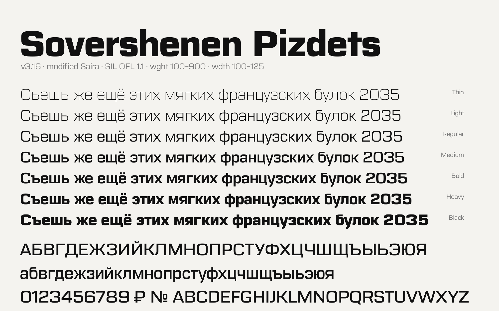

# Sovershenen Pizdets



**Version 3.16** · SIL Open Font License 1.1

**RU.** Квадратный гротеск на базе [Saira](https://github.com/Omnibus-Type/Saira) (Héctor Gatti, Omnibus-Type), которая распространяется под свободной лицензией SIL Open Font License 1.1. Добавлена полная кириллица (RU, UA, BY), перерисованы буквы и цифры, пересобраны метрики, веса и кернинг. Подходит для интерфейсов, навигации и техники.

**EN.** A square grotesque based on [Saira](https://github.com/Omnibus-Type/Saira) by Héctor Gatti / Omnibus-Type, which is free software under the SIL Open Font License 1.1. Adds full Cyrillic (Russian, Ukrainian, Belarusian), redraws letters and figures, and rebalances metrics, weights and kerning. Made for interfaces, wayfinding and technical use.

> Шрифт, возможно, будет обновляться, но это не обещание. / The font may get updates, but no promises.

## Fonts / Шрифты

| Path | Contents |
|---|---|
| `fonts/variable/SovershenenPizdets[wdth,wght].ttf` | Variable: `wght` 100–900, `wdth` 100–125 |
| `fonts/otf/`, `fonts/ttf/` | Static: Thin, Light, Regular, Medium, Bold, Heavy, Black |
| `fonts/webfonts/` | WOFF2 of all of the above |
| `sources/` | UFO masters + designspace (build with fontmake) |

Static styles are cut at `wdth` 116. From Heavy (800) to Black (900) the face widens gradually: Black sits at the equivalent of `wdth` 127.

Статика собрана на `wdth` 116. От Heavy (800) к Black (900) шрифт плавно расширяется: Black соответствует `wdth` 127.

```css
@font-face {
  font-family: "Sovershenen Pizdets";
  src: url("SovershenenPizdets[wdth,wght].woff2") format("woff2");
  font-weight: 100 900;
  font-stretch: 100% 125%;
}
.text { font-family: "Sovershenen Pizdets", sans-serif; font-variation-settings: "wdth" 116; }
```

## Build / Сборка

```sh
pip install fontmake
fontmake -m sources/SovershenenPizdets.designspace -o variable
fontmake -m sources/SovershenenPizdets.designspace -i -o otf ttf
```

## License / Лицензия

SIL Open Font License 1.1, see [OFL.txt](OFL.txt). This is a Modified Version of Saira, © 2020 The Saira Project Authors (https://github.com/Omnibus-Type/Saira), released under the same license. Saira declares no Reserved Font Name. Not affiliated with or endorsed by Omnibus-Type.

Модифицированная версия Saira, © 2020 The Saira Project Authors, под той же лицензией OFL 1.1. Проект не связан с Omnibus-Type и не одобрен ими.
